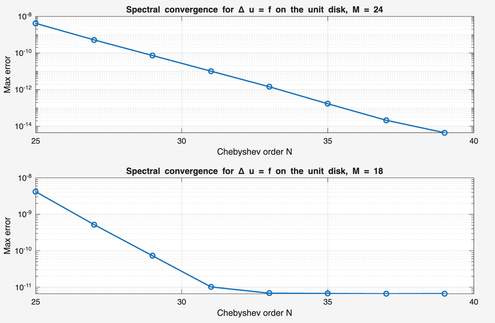

# Spectral Methods in PDEs

MATLAB code for my final-year essay *Spectral Methods in Partial Differential Equations* (MA395, University of Warwick, April 2026), supervised by Prof Dwight Barkley. The essay is [`MA395_essay.pdf`](MA395_essay.pdf).

The essay studies Fourier and Chebyshev pseudospectral methods and compares them with second-order finite differences and piecewise-linear (P1) finite elements on transport problems, boundary-value problems, and Poisson problems on the square and the unit disk.

## Key results

`key_results.m` in `GitHub codes/` prints the numbers in the first two items in a few seconds, without plots.

- **Neumann problem −Δu + u = f on [−1,1]² with a smooth exact solution (Figures 19–20).** With the same 625 nodes (N = 24 in each direction), the maximum nodal error is about 10⁻¹³ for Chebyshev collocation (rounding level, so the exact value varies slightly between machines) and 7.9 × 10⁻³ for P1 finite elements. This compares accuracy on one smooth test problem, not computational cost.
- **Poisson equation on the unit disk (Figure 21, below).** With Fourier order M = 24 the maximum error decays exponentially in the Chebyshev order N, from 4 × 10⁻⁹ at N = 25 to 4 × 10⁻¹⁵ at N = 39. With M = 18 it levels off at about 7 × 10⁻¹² from N = 33 onwards, so the angular resolution limits the accuracy.
- **Regularity and convergence (Figure 10).** The convergence rate of Chebyshev differentiation improves from algebraic to exponential as the regularity of the test function increases.

*Essay Figure 21, produced by `figure_21.m`: maximum error against the Chebyshev order N for Fourier order M = 24 (top) and M = 18 (bottom).*

## Sources and use of AI

Several scripts follow programs from L. N. Trefethen, *Spectral Methods in MATLAB* (SIAM, 2000), as acknowledged in the essay; the table gives the source of each script. `cheb.m` is Trefethen's routine. The finite-difference and finite-element comparisons, the Neumann problem on the square, the manufactured solutions and the convergence studies were written for the essay.

As stated in the essay, generative AI was used to help with plotting in some scripts. `figure_17.m` was also written with the assistance of a generative AI tool. `key_results.m` was added in October 2026, after the essay, with the assistance of a generative AI tool; it repeats the computations of `figure_19.m`, `figure_20.m` and `figure_21.m` without plotting.

| Script | Essay figure | What it computes | Source |
| --- | --- | --- | --- |
| `cheb.m` | – | Chebyshev differentiation matrix | Trefethen (2000), `cheb.m` |
| `barycheb1.m` | – | Barycentric interpolation at Chebyshev points | Formula from Berrut & Trefethen (2004) |
| `figure_1.m` | 1 | Values of J(t, N/2) for several t and N | Written for the essay |
| `figure_2and3.m` | 2–3 | Fourier differentiation of a hat function and of e^(sin x); comparison with central differences | Examples adapted from Tang (2006), as stated in the essay; code follows Trefethen (2000), Program 4; finite-difference comparison written for the essay |
| `figure_4.m` | 4 | Variable-coefficient transport equation: Fourier differentiation with backward Euler | Problem from Trefethen (2000), Program 6; time stepping changed to backward Euler |
| `figure_5.m` | 5 | Same problem: central finite differences with backward Euler | Problem from Program 6; finite-difference version written for the essay |
| `figure_7.m` | 7 | Polynomial interpolation in equispaced and Chebyshev points | Adapted from Program 9 |
| `figure_9.m` | 9 | Chebyshev differentiation of e^x sin 5x | Adapted from Program 11; barycentric interpolation of the derivative added |
| `figure_10.m` | 10 | Accuracy of Chebyshev differentiation for functions of different regularity | Adapted from Program 12 |
| `figure_12.m` | 12 | u'' = e^(4x) with Dirichlet conditions, Chebyshev collocation | Adapted from Program 13; barycentric interpolation replaces polynomial fitting |
| `figure_13.m` | 13 | Same problem with finite differences | Written for the essay |
| `figure_16.m` | 16 | Poisson equation on [−1,1]², Chebyshev collocation | Adapted from Program 16; manufactured solution and barycentric plotting added |
| `figure_17.m` | 17 | Same problem with second-order finite differences | Written with the assistance of a generative AI tool |
| `figure_18.m` | 18 | u'' = e^(4x) with mixed Dirichlet–Neumann conditions; convergence in N | Problem from Program 33; convergence study written for the essay |
| `figure_19.m` | 19 | −Δu + u = f on [−1,1]² with Neumann conditions, Chebyshev collocation | Written for the essay |
| `figure_20.m` | 20 | Same problem with P1 finite elements | Written for the essay |
| `figure_21.m` | 21 | Poisson equation on the unit disk (Fourier–Chebyshev); convergence in N for M = 18 and 24 | Discretisation follows Program 29; manufactured solution and convergence study written for the essay |
| `figure_23.m` | 23 | Fourier differentiation via the FFT | Adapted from Program 5 |
| `key_results.m` | 19–21 | Prints the numbers under Key results | Added after the essay with the assistance of a generative AI tool; same computations as `figure_19.m`, `figure_20.m` and `figure_21.m` |

## Running

The scripts are in `GitHub codes/`. In MATLAB, change to that folder and run a script by name, for example `figure_21`; `key_results` prints the numbers under Key results. `figure_21.m` defines a local function, which requires MATLAB R2016b or later.

## References

1. L. N. Trefethen, *Spectral Methods in MATLAB*, SIAM, 2000.
2. J.-P. Berrut and L. N. Trefethen, "Barycentric Lagrange interpolation," *SIAM Review* 46(3), 501–517, 2004.
3. T. Tang, *Spectral and High-Order Methods with Applications*, Science Press, Beijing, 2006.
